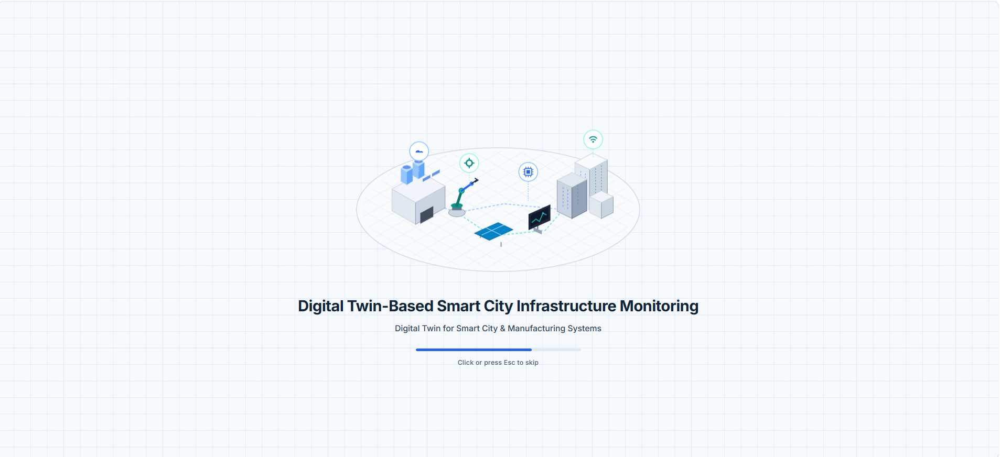
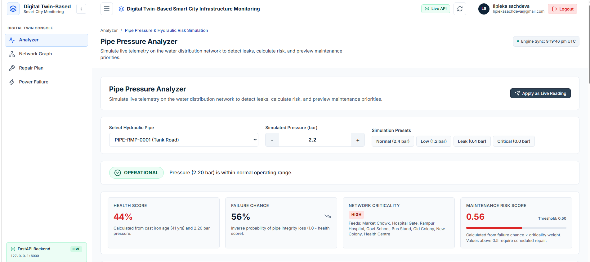
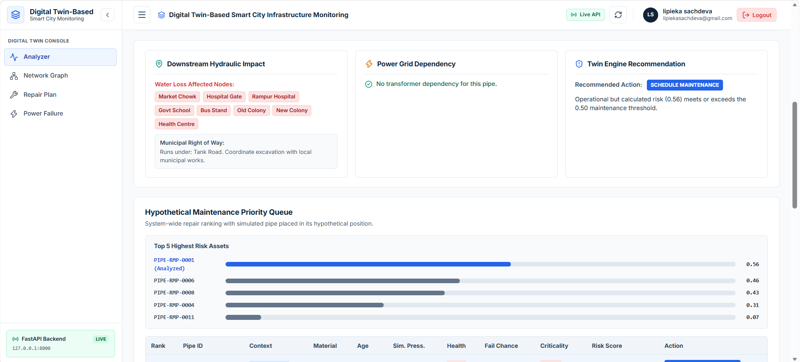
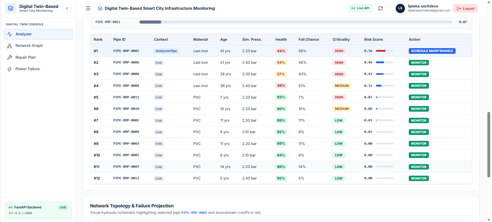
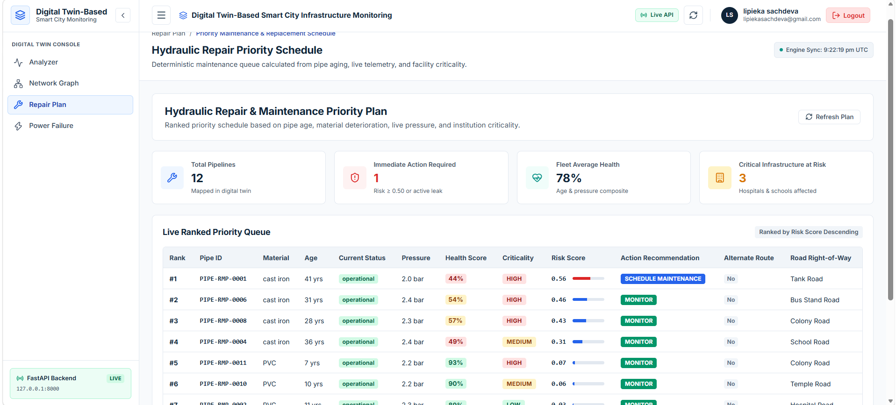
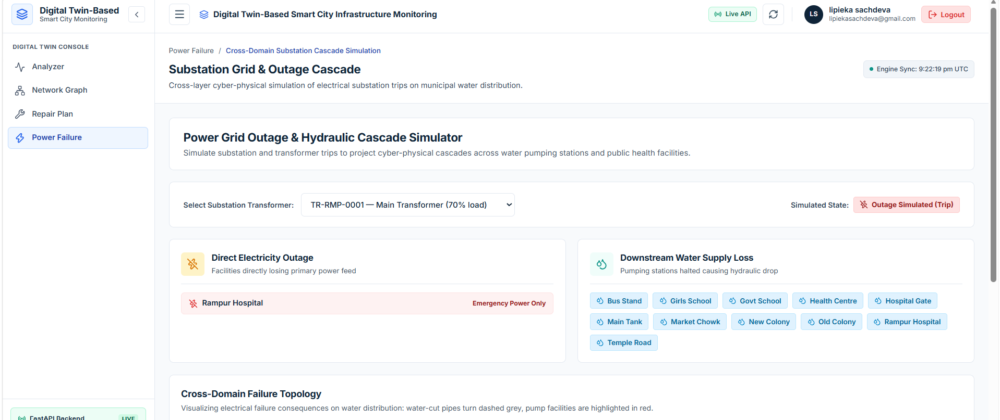

Digital Twin Based Smart City Infrastructure Monitoring

A digital twin platform for monitoring and predicting the performance of smart city infrastructure. The project models the town of Rampur and lets users view the state of key utilities, spot problems, and plan repairs from a single dashboard.

Features
Power Grid monitoring: view the status and load of the electrical network
Water Network monitoring: track the water supply infrastructure
Repair Plan: prioritise and plan maintenance based on the twin's data
Digital twin engine: a Python backend that simulates and stores the city's infrastructure state
Persistent state: runtime state is saved so the twin can continue where it left off
Tech Stack:
frontend:-React,Vite,CSS
backend:-Python
Testing:-pytest
PROJECT STRUCTURE:-
digital twin smart city/
├── BACKEND/
│   ├── app.py              # Backend entry point
│   ├── requirements.txt    # Python dependencies
│   ├── pytest.ini
│   ├── data/               # Rampur city data
│   ├── twin/               # Digital twin logic (core, pro, storage)
│   └── tests/              # Unit tests
├── FRONTEND/
│   ├── src/
│   │   ├── pages/          # Power Grid, Water Network, Repair Plan pages
│   │   └── styles/         # CSS files
│   ├── public/
│   ├── index.html
│   ├── package.json
│   └── vite.config.js
└── README.md
Getting Started
Prerequisites:-
Python 3.9+
Node.js 18+
Git
1. Clone the repository
git clone https://github.com/lsachdevabe25/Digital-Twin-Based-Smart-City-Infrastructure-Monitoring-.git
cd Digital-Twin-Based-Smart-City-Infrastructure-Monitoring-
2. Run the backend
cd BACKEND
python -m venv venv
venv\Scripts\activate        # Windows
# source venv/bin/activate   # macOS / Linux
pip install -r requirements.txt
python app.py
3. Run the frontend

Open a second terminal:

bash
cd FRONTEND
npm install
npm run dev

Then open the local URL shown in the terminal (usually http://localhost:5173).
Environment variables

Copy FRONTEND/.env.example to FRONTEND/.env and fill in the values. The .env file is not uploaded to GitHub.
Running Tests
bash
cd BACKEND
pytest
Screenshots

Author

Lipieka Sachdeva Thapar Institute of Engineering and Technology

License

This project is for academic purposes.